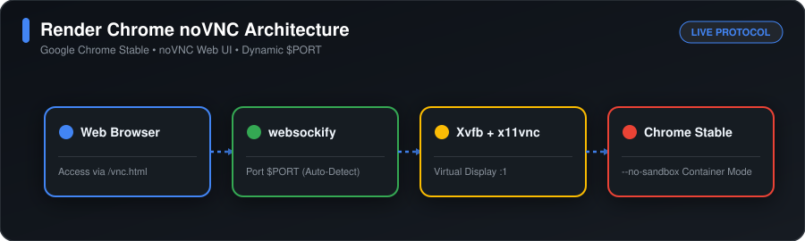

<h1 align="center">🌐 Cloud Chrome noVNC (Render & Railway)</h1>

<p align="center">
  <a href="https://github.com/itzxsahil">
    
  </a>
</p>

<p align="center">
    
</p>

---

## 📸 Project Preview

<p align="center">
  
</p>

---

# 🚀 Overview

Containerized official **Google Chrome Stable** running on an Ubuntu virtual desktop, exposed through **noVNC** over WebSockets for instant web-based browser streaming.

---

# 🏗️ System Architecture & Data Flow

<p align="center">
  
</p>

<br>

A virtual X11 frame buffer runs Google Chrome with hardware acceleration fallback flags; x11vnc shares the display to websockify, delivering an interactive HTML5 desktop to your browser.

---

# ✨ Features

✅ **Official Chrome Stable**: Installed from Google's official repositories.\n✅ **Automatic Root Redirect**: Navigating to `/` redirects straight to `/vnc.html`.\n✅ **Dynamic Port Support**: Handles Render's `$PORT` and Railway environments automatically.

---

# 📦 Installation & Quickstart

```bash
docker build -t render-chrome-novnc .
docker run -p 6080:6080 render-chrome-novnc
```\nOpen `http://localhost:6080` in your web browser.

---

# 👤 Author & Support
- Built with ❤️ by [@itzxsahil](https://github.com/itzxsahil)
- Star ⭐ this repository if you find it helpful!
